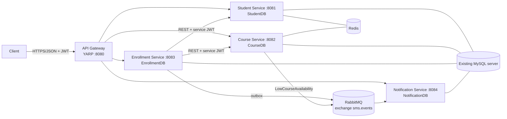
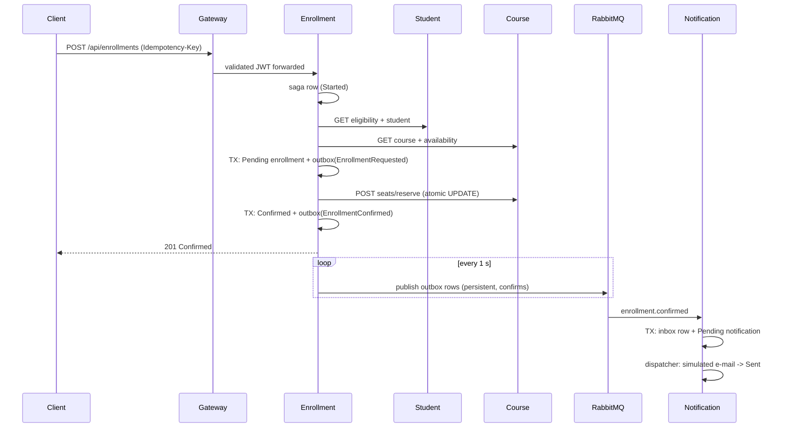

# Student Management System - ASP.NET Core Microservices

A student/course enrolment system built as four independent **ASP.NET Core 8** microservices behind a **YARP API Gateway**, using **MySQL** (existing server), **RabbitMQ**, **Redis**, **JWT + ASP.NET Identity**, **Serilog**, **OpenTelemetry**, **Prometheus/Grafana**, Docker Compose and Kubernetes manifests. It demonstrates database-per-service, synchronous REST with resilience, event-driven messaging, an orchestrated **saga**, the **transactional outbox**, inbox/idempotency, **CQRS** and atomic seat concurrency control.

> Detailed per-feature documentation (14-point template each) is in [`Documentation/`](Documentation/). The same system in Java/Spring Boot lives in `~/Documents/Java_Projects/StudentManagement`.

## Contents
1. [Microservices architecture](#microservices-architecture) - 2. [Services](#responsibilities-of-each-service) - 3. [Stack](#technology-stack) - 4. [Folders](#solution-folder-structure) - 5. [MySQL](#existing-mysql-database-configuration) - 6. [Migrations](#ef-core-migration-instructions) - 7. [Endpoints](#api-endpoints) - 8. [Gateway](#api-gateway-routing) - 9. [REST](#synchronous-communication) - 10. [RabbitMQ](#rabbitmq-exchanges-queues-and-events) - 11. [Saga](#saga-workflow) - 12. [Outbox](#outbox-implementation) - 13. [CQRS](#cqrs-implementation) - 14. [Redis](#redis-caching) - 15. [Auth](#authentication-and-authorization) - 16. [Logging/monitoring](#logging-and-monitoring) - 17. [Docker](#docker-setup) - 18. [Kubernetes](#kubernetes-deployment) - 19. [Testing](#testing-instructions) - 20. [Samples](#sample-api-requests-and-responses) - 21. [Troubleshooting](#troubleshooting) - 22. [Checklist](#checklist-completed-and-pending) - 23. [Documentation index](#documentation-index)

## Quick start
```bash
cd ~/Documents/DotNet_Projects/StudentManagement
cp .env.example .env                      # then fill MYSQL_USER / MYSQL_PASSWORD / JWT_SECRET / ADMIN_PASSWORD (only needed for Docker Compose)
docker compose up -d rabbitmq redis jaeger prometheus grafana     # infrastructure (host MySQL must already be running)
export PATH=$PATH:$HOME/.dotnet:$HOME/.dotnet/tools
dotnet build StudentManagement.sln
scripts/start-local.sh                    # 4 services + gateway as local processes (logs in logs/)
python3 scripts/e2e.py                    # 49 end-to-end checks through the gateway
python3 scripts/failure-scenarios.py      # broker outage / dependency outage
scripts/stop-local.sh
```
URLs: gateway `http://localhost:8080` - Swagger `http://localhost:8080/swagger` - RabbitMQ UI `http://localhost:15672` - Jaeger `http://localhost:16686` - Prometheus `http://localhost:9090` - Grafana `http://localhost:3001`.
Login with the seeded `admin` account (password = `Bootstrap:AdminPassword`; a development default is in `Services/StudentService/appsettings.json`, override with `Bootstrap__AdminPassword`).

## Microservices architecture

Rules: each service owns its database; **no** cross-database foreign keys; services communicate only through REST or RabbitMQ; clients enter only through the gateway.

### Enrollment sequence

Failure path: any failed step -> *Compensating*: release the seat (idempotent), mark the enrolment `Rejected`, outbox `EnrollmentRejected`, respond `422` with the reason.

## Responsibilities of each service
| Service | Port | Database | Responsibilities |
|---|---|---|---|
| Student | 8081 | StudentDB | student CRUD/search/status/eligibility, **identity** (users, roles, login, refresh tokens) |
| Course | 8082 | CourseDB | course + category CRUD/search, availability, atomic seat reserve/release, low-availability events |
| Enrollment | 8083 | EnrollmentDB | enrol/cancel/update, history/search, saga, outbox, CQRS |
| Notification | 8084 | NotificationDB | consume events, inbox, notification history, simulated e-mail with retry |
| API Gateway | 8080 | - | routing, JWT validation, correlation id, CORS, 503 fallback, Swagger aggregation |

## Technology stack
C# 12 / .NET 8 (LTS; SDK 8.0.422) - ASP.NET Core Web API - EF Core 8.0.10 + Pomelo.EntityFrameworkCore.MySql 8.0.2 - YARP 2.2.0 - ASP.NET Core Identity + JwtBearer - RabbitMQ.Client 6.8.1 (RabbitMQ 3.13) - Redis 7 (StackExchange.Redis) - Microsoft.Extensions.Http.Resilience 8.10 - Serilog 8.0.3 - OpenTelemetry 1.9 - Prometheus 2.55 + Grafana 11.3 + Jaeger 1.62 - xUnit 2.9 + Moq 4.20 + Testcontainers 3.10 - Docker / Docker Compose - Kubernetes (kustomize).

## Solution folder structure
```
StudentManagement/
  StudentManagement.sln, Directory.Build.props, docker-compose.yml, .env.example
  ApiGateway/                       YARP gateway
  Services/{Student,Course,Enrollment,Notification}Service/
      Controllers/ Entities/ Dtos/ Data/(Configurations, Migrations) Repositories/ Services/ Middleware/ Configurations/
      (Enrollment: Commands/ Queries/ Saga/ Outbox/ EventHandlers/ Clients/)  (Notification: Consumers/ Processing/)
  BuildingBlocks/{Common,EventContracts,Messaging,Observability}/
  Tests/{UnitTests,IntegrationTests}/
  Docker/ (Dockerfile, healthcheck.sh)  Kubernetes/  Monitoring/{Prometheus,Grafana}/  scripts/  Documentation/
```
(`Middleware/` and `Configurations/` folders inside services are kept for the required structure; the shared middleware lives in `BuildingBlocks/Common/Web`.)

## Existing MySQL database configuration
The four **existing** databases are used as they are: `StudentDB`, `CourseDB`, `EnrollmentDB`, `NotificationDB` on the host MySQL (127.0.0.1:3306). Nothing is dropped, renamed, recreated or truncated. The migrations only **add** tables prefixed `dn_` (plus `__EFMigrationsHistory`), so they cannot collide with the tables already there (including the `sms_*` tables of the Java version). Verify existing data is untouched with `SELECT COUNT(*)` on your original tables.

### Connection strings
Each `appsettings.json` has e.g. `"ConnectionStrings": {"StudentDb": "Server=localhost;Port=3306;Database=StudentDB;User=<user>;Password=<password>;"}`. In this workspace the local development login is pre-filled so the project runs out of the box; override with environment variables - never commit real credentials:
```bash
export ConnectionStrings__StudentDb="Server=localhost;Port=3306;Database=StudentDB;User=YOUR_MYSQL_USER;Password=YOUR_MYSQL_PASSWORD;"
```
Docker: `MYSQL_HOST` (default `host.docker.internal`), `MYSQL_PORT`, `MYSQL_USER`, `MYSQL_PASSWORD` in `.env`. Keys per service: `StudentDb`, `CourseDb`, `EnrollmentDb`, `NotificationDb`.

## EF Core migration instructions
```bash
export PATH=$PATH:$HOME/.dotnet:$HOME/.dotnet/tools     # dotnet-ef 8.0.10 installed as a global tool
cd Services/CourseService
dotnet ef migrations add AddSomething -o Data/Migrations
dotnet ef migrations script -o /tmp/course.sql          # ALWAYS review: only CREATE/ALTER ADD, never DROP
```
Migrations are applied automatically at service start (`Database:MigrateOnStartup=true`); `dotnet ef database update` also works (set `ConnectionStrings__CourseDb`). A design-time factory per service means the tools never start the web host. All four initial migrations were rendered to SQL and checked: no DROP/TRUNCATE/DELETE.

## API endpoints
All paths via the gateway (`:8080`). Roles: **A**dmin, **S**taff, **St**udent, **Sv** (Service, internal). "own" = a Student user may only access their own data.
| Method + path | Roles | Purpose |
|---|---|---|
| POST `/api/auth/register` | public (Admin token for Staff/Admin) | register |
| POST `/api/auth/login` `/refresh` `/logout` | public | tokens |
| GET `/api/auth/me` | any | current user |
| POST/GET `/api/students` | A,S | create / search (`search,status,gender,page,size,sort`) |
| GET `/api/students/{id}` | A,S,Sv,St(own) | get |
| PUT `/api/students/{id}` | A,S,St(own; no status) | update |
| PATCH `/api/students/{id}/status` | A,S | Active/Inactive |
| DELETE `/api/students/{id}` | A | delete |
| GET `/api/students/{id}/eligibility` | A,S,Sv | eligible = Active |
| POST/GET/PUT/DELETE `/api/courses/categories[/{id}]` | write A,S (delete A); read any | categories |
| POST `/api/courses` | A,S | create |
| GET `/api/courses` | any | search (`search,categoryId,status,minFees,maxFees,availableOnly,page,size,sort`) |
| GET `/api/courses/{id}` `/{id}/availability` | any | details / seats (cached) |
| PUT / PATCH status `/api/courses/{id}` | A,S | update / activate |
| DELETE `/api/courses/{id}` | A | delete |
| POST `/api/courses/{id}/seats/reserve` `/release` | A,Sv | atomic seat ops |
| POST `/api/enrollments` | A,S,St(self) | enrol (`Idempotency-Key`) -> 201 / 422 / 202 / 409 |
| POST `/api/enrollments/{id}/cancel` | A,S,St(own) | cancel Confirmed |
| PUT `/api/enrollments/{id}` | A,S | remarks |
| GET `/api/enrollments/{id}` | A,S,St(own) | get |
| GET `/api/enrollments` | A,S | search (`studentId,courseId,status,from,to,page,size,sort`) |
| GET `/api/enrollments/student/{studentId}` | A,S,St(own) | history |
| GET `/api/enrollments/course/{courseId}` | A,S | course enrolments |
| GET `/api/notifications` `/{id}` | A,S | history |
| GET `/api/notifications/student/{studentId}` | A,S,St(own) | student history |
| POST `/api/notifications/{id}/retry` | A,S | re-queue Failed |
| GET `/gateway/routes`, `/swagger`, `/health*`, `/metrics` | public | operations |
Error body: `{"timestamp","status","error","message","path","fieldErrors?","correlationId?"}` (400 validation, 401, 403, 404, 409, 422, 503).

## API Gateway routing
YARP routes (see `ApiGateway/appsettings.json`, `Documentation/07-API-Gateway-YARP.md`): `/api/auth/{login|register|refresh|logout}` public -> Student; `/api/auth/**`, `/api/students/**` -> Student; `/api/courses/**` -> Course; `/api/enrollments/**` -> Enrollment; `/api/notifications/**` -> Notification (all JWT-protected); `/docs/<name>/swagger.json` public. Unreachable cluster -> `503`.

## Synchronous communication
Enrollment -> Student/Course via `IHttpClientFactory` typed clients with a service JWT, correlation id, status-code mapping and a resilience pipeline: total timeout 12 s, retry 3x (exponential + jitter, only for 5xx/408/429/network), circuit breaker (50 % failures, min 5 calls, 10 s open), per-attempt timeout 4 s. Business answers (404/409/4xx) are never retried. See `Documentation/08`, `16`.

## RabbitMQ exchanges, queues and events
| Item | Value |
|---|---|
| Exchange | `sms.events` (topic, durable); dead-letter exchange `sms.events.dlx` (direct) |
| Queues | `notification.enrollment-events` (`enrollment.*`), `notification.course-events` (`course.*`); DLQs `<queue>.dlq` |
| Events | `EnrollmentRequested` `enrollment.requested`, `EnrollmentConfirmed` `enrollment.confirmed`, `EnrollmentRejected` `enrollment.rejected`, `EnrollmentCancelled` `enrollment.cancelled`, `LowCourseAvailability` `course.low-availability` |
| Delivery | persistent messages, publisher confirms, manual ack, 4 in-process attempts with back-off then dead-letter |
Details and event schemas: `Documentation/09`, `25`.

## Saga workflow
Orchestrated in `EnrollmentSagaOrchestrator`, state persisted in `dn_saga_instances` after every step: Started -> StudentValidated -> CourseValidated -> PendingCreated (outbox: Requested) -> SeatReserved -> Completed (outbox: Confirmed). Any failure -> Compensating (release seat, Rejected + outbox Rejected). `SagaRecoveryJob` resumes stuck sagas. `Documentation/10`.

## Outbox implementation
Events are inserted into `dn_outbox_messages` in the same transaction as the business change; `OutboxPublisher` (BackgroundService, 1 s) locks due rows with `FOR UPDATE SKIP LOCKED`, publishes with confirms, marks `Published`, retries with back-off, keeps per-enrollment ordering. Inbox: `dn_inbox_messages` in NotificationDB. `Documentation/11`, `12`.

## CQRS implementation
Commands (`Create/Cancel/UpdateEnrollmentCommand` + handlers) and queries (`Get/Search/StudentHistory/CourseEnrollments` + `EnrollmentQueryHandlers`) are separate classes in `Services/EnrollmentService/Commands` and `Queries`. `Documentation/13`.

## Redis caching
`student:{id}` (10 min), `course:{id}` (10 min), `course-availability:{id}` (1 min); updated/evicted on change; Redis failure falls back to MySQL. `Documentation/14`.

## Authentication and authorization
ASP.NET Core Identity (PBKDF2 hashes), JWT HS256 access tokens (15 min), rotating refresh tokens (SHA-256 stored), roles Admin/Staff/Student (+ internal Service), lockout after 5 failures. **Ownership:** identity tables live in StudentDB, owned by Student Service - no fifth service/database. `Documentation/15`.

## Logging and monitoring
Serilog console logs with `[service,traceId,correlationId]`; OpenTelemetry traces (OTLP -> Jaeger) across gateway, services and the RabbitMQ hop; metrics at `/metrics` scraped by Prometheus (dashboard `Monitoring/Grafana/dashboards/sms-overview.json`); health: `/health/live`, `/health/ready` (MySQL, RabbitMQ, Redis). `Documentation/19`-`21`.

## Docker setup
`docker compose up -d rabbitmq redis jaeger prometheus grafana` starts infrastructure (persistent volumes for RabbitMQ, Redis, Grafana). `docker compose --profile apps up -d --build` adds the gateway and four services (one parameterised `Docker/Dockerfile`, health checks, startup dependencies). **MySQL is not containerised**: containers use `MYSQL_HOST` (default `host.docker.internal`). The host MySQL on this machine listens on 127.0.0.1 only, so containers cannot reach it until you either bind it to the docker bridge address, or run a loopback TCP proxy - the same options documented in the Java project (`../../Java_Projects/StudentManagement/docker/README.md`). `Documentation/22`.

## Kubernetes deployment
Optional: `kubectl apply -k Kubernetes/` after creating the `sms-secrets` secret and editing `02-mysql-external.yaml`. `Documentation/23`.

## Testing instructions
```bash
dotnet test Tests/UnitTests                    # 84 tests, no Docker
dotnet test Tests/IntegrationTests             # 37 tests, Testcontainers (MySQL 8, RabbitMQ, Redis) - needs Docker
scripts/start-local.sh && python3 scripts/e2e.py && python3 scripts/failure-scenarios.py
```
Automated tests never use the real databases. `Documentation/24`.

## Sample API requests and responses
```bash
TOKEN=$(curl -s -XPOST localhost:8080/api/auth/login -H 'Content-Type: application/json' \
  -d '{"username":"admin","password":"<admin password>"}' | python3 -c 'import json,sys;print(json.load(sys.stdin)["accessToken"])')
curl -s -XPOST localhost:8080/api/students -H "Authorization: Bearer $TOKEN" -H 'Content-Type: application/json' \
  -d '{"firstName":"Asha","lastName":"Rao","email":"Asha.Rao@Example.com","phoneNumber":"+91 9876543210","gender":"Female"}'
```
```json
{"studentId":1,"firstName":"Asha","lastName":"Rao","email":"asha.rao@example.com","phoneNumber":"+91 9876543210","dateOfBirth":null,"gender":"Female","address":null,"enrollmentDate":"2026-11-10","status":"Active","createdAt":"2026-11-10T13:10:15.1477578Z","updatedAt":"2026-11-10T13:10:15.1477578Z"}
```
Validation failure (`400`): `{"timestamp":"...","status":400,"error":"Bad Request","message":"Validation failed","path":"/api/students","fieldErrors":{"email":["The Email field is not a valid e-mail address."],"firstName":["The FirstName field is required."],"phoneNumber":["must be a valid phone number (7-15 digits, optional leading +)"]}}`
Enrol (`201`): `curl -XPOST localhost:8080/api/enrollments -H "Authorization: Bearer $TOKEN" -H 'Idempotency-Key: demo-1' -H 'Content-Type: application/json' -d '{"studentId":1,"courseId":1}'`
```json
{"result":"Confirmed","message":"Enrollment confirmed","enrollment":{"enrollmentId":1,"studentId":1,"courseId":1,"studentName":"Asha Rao","courseName":"Java","enrollmentDate":"2026-11-10T13:32:02.420397","enrollmentStatus":"Confirmed","remarks":null,"createdAt":"2026-11-10T13:32:02.420397","updatedAt":"2026-11-10T13:32:04.685292"}}
```
Sold out (`422`): `{"result":"Rejected","message":"Seat reservation failed: no seats available","enrollment":{... "enrollmentStatus":"Rejected" ...}}`. Seat availability: `{"courseId":1,"status":"Active","totalSeats":4,"availableSeats":0,"available":false}`. Service down: `{"status":503,"error":"Service Unavailable","message":"course is currently unavailable. Please retry shortly."}`.

## Troubleshooting
| Symptom | Check |
|---|---|
| Service does not start: `Jwt:Secret must be at least 32 characters` | set `Jwt__Secret` (same value everywhere) |
| `Unable to connect to any of the specified MySQL hosts` | host MySQL up? connection string env? in Docker see the MySQL note above |
| `refers to non-existing column` in a migration | CHECK/computed SQL must use the real (PascalCase) column names |
| 401 from every call | token expired (15 min) -> `/api/auth/refresh`; or different `Jwt__Secret` in a service |
| Events not arriving | `docker exec sms-dn-rabbitmq rabbitmqctl list_queues name messages consumers`; outbox rows: `SELECT Status, Attempts, LastError FROM EnrollmentDB.dn_outbox_messages` |
| Messages in a `.dlq` queue | consumer failed 4x: read the message in the RabbitMQ UI, fix, re-publish |
| Port already in use | `scripts/stop-local.sh` |
| Weird behaviour after rebuilding while services run | stop services before `dotnet build`, then start again |
| Integration tests fail to start | Docker running? images pullable? |

## Checklist (completed and pending)
Legend: [x] implemented **and** verified as described - [~] implemented, partially verified - [ ] not done.

**Phases**
- [x] Phase 1 Solution setup, MySQL connections, EF migrations, CRUD APIs (4 services)
- [x] Phase 2 API Gateway (YARP): routing, central auth, correlation id, 503
- [x] Phase 3 Synchronous communication (typed HttpClients)
- [x] Phase 4 RabbitMQ publishing/consuming, Notification integration
- [x] Phase 5 Saga + compensation + outbox + idempotency
- [x] Phase 6 Identity, JWT, roles, refresh tokens
- [x] Phase 7 Redis, CQRS, retry/timeout/circuit breaker, concurrency control
- [x] Phase 8 Serilog, OpenTelemetry (Jaeger), Prometheus + Grafana, health checks
- [~] Phase 9 Docker: Dockerfile + compose written, **images built** (see `Documentation/22`); the containerised application stack was **not run end to end** because containers cannot reach the host MySQL (listens on loopback only)
- [~] Phase 10 Tests done; Kubernetes manifests written and syntax-checked but **not applied**

**Acceptance criteria (section 17 of the specification)**
1. [x] Four services run independently - 2. [x] Each connects to its own existing database - 3. [x] Existing databases/data preserved - 4. [x] EF migrations work with MySQL - 5. [x] APIs reachable through YARP - 6. [x] Student/Course validation via REST - 7. [x] RabbitMQ publish/consume - 8. [x] End-to-end enrolment - 9. [x] Seat reserve/release - 10. [x] Saga compensation - 11. [x] Outbox publishes pending events (incl. after broker outage) - 12. [x] Duplicate enrolment/message prevention - 13. [x] Redis caching - 14. [x] JWT + roles - 15. [x] Logging, tracing (Jaeger), metrics (Prometheus), health - 16. [~] Docker Compose: infra runs; application containers need host-MySQL connectivity - 17. [x] Unit + integration tests pass - 18. [x] README complete.

**Known gaps:** application containers vs host MySQL (above); Kubernetes not applied; development default credentials in `appsettings.json`; OpenTelemetry OTLP exporter package has a moderate advisory (NU1902); no real e-mail; no access-token revocation.

## Documentation index
[00 Overview](Documentation/00-Project-Overview.md) - [01 Solution setup](Documentation/01-Solution-Setup.md) - [02 MySQL](Documentation/02-MySQL-Database-Configuration.md) - [03 Student](Documentation/03-Student-Service.md) - [04 Course](Documentation/04-Course-Service.md) - [05 Enrollment](Documentation/05-Enrollment-Service.md) - [06 Notification](Documentation/06-Notification-Service.md) - [07 Gateway](Documentation/07-API-Gateway-YARP.md) - [08 Service-to-service](Documentation/08-Service-to-Service-Communication.md) - [09 RabbitMQ](Documentation/09-RabbitMQ-Event-Driven-Architecture.md) - [10 Saga](Documentation/10-Saga-Pattern.md) - [11 Outbox](Documentation/11-Outbox-Pattern.md) - [12 Idempotency](Documentation/12-Idempotency.md) - [13 CQRS](Documentation/13-CQRS-Implementation.md) - [14 Redis](Documentation/14-Redis-Caching.md) - [15 Auth](Documentation/15-Authentication-and-Authorization.md) - [16 Resilience](Documentation/16-Resilience-Patterns.md) - [17 Concurrency](Documentation/17-Concurrency-Control.md) - [18 Background](Documentation/18-Background-Processing.md) - [19 Logging/monitoring](Documentation/19-Logging-and-Monitoring.md) - [20 Tracing](Documentation/20-OpenTelemetry-and-Distributed-Tracing.md) - [21 Health](Documentation/21-Health-Checks.md) - [22 Docker](Documentation/22-Docker-and-Docker-Compose.md) - [23 Kubernetes](Documentation/23-Kubernetes.md) - [24 Testing](Documentation/24-Unit-and-Integration-Testing.md) - [25 API docs](Documentation/25-API-Documentation.md) - [26 Configuration](Documentation/26-Configuration-and-Environment-Variables.md) - [27 Change log](Documentation/27-Implementation-Change-Log.md)
