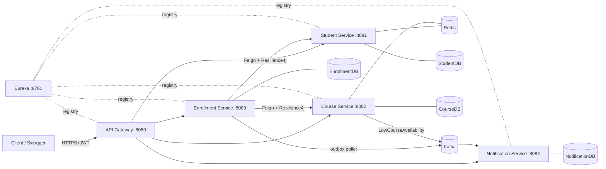

# 00 – Project Overview

## 1. Feature Overview
A Student Management System built as four independent Spring Boot 3.4 / Java 21 microservices behind a Spring Cloud Gateway, with Netflix Eureka discovery, Kafka messaging, Redis caching, JWT security, Resilience4j, OpenTelemetry/Prometheus/Grafana observability, Docker Compose and optional Kubernetes manifests.

| Component | Port | Database / store | Responsibility |
|---|---|---|---|
| `api-gateway` | 8080 | – | Single entry point, JWT edge check, CORS, correlation id, circuit-breaker fallbacks, Swagger aggregation |
| `eureka-server` | 8761 | – | Service registry |
| `student-service` | 8081 | StudentDB, Redis | Students + **authentication** (users, JWT, refresh tokens) |
| `course-service` | 8082 | CourseDB, Redis, Kafka | Courses, categories, seat reservation, `LowCourseAvailability` events |
| `enrollment-service` | 8083 | EnrollmentDB, Kafka | Enrollment saga (orchestration), outbox, CQRS |
| `notification-service` | 8084 | NotificationDB, Kafka | Kafka consumers, inbox, notification history, retrying dispatcher |
| Infrastructure | 9092 / 6379 / 16686 / 9090 / 3001 | – | Kafka (KRaft), Redis, Jaeger, Prometheus, Grafana |

## 2. Purpose
Demonstrate, with working and verified code, database-per-service, API gateway, service discovery, synchronous (Feign) and asynchronous (Kafka) communication, saga + outbox + inbox + idempotency, CQRS, caching, resilience, security and observability on top of the **existing** MySQL server and its four existing databases.

## 3. Files Created
The complete file inventory is split per feature in documents 01–28. Top level:

| File Path | Change Type | Description |
|---|---|---|
| pom.xml | Created | Parent POM / Maven reactor ([01](01-Project-Setup-and-Maven-Configuration.md)) |
| README.md | Created | Setup, architecture, API reference, checklist |
| docker-compose.yml | Created | Infrastructure + application containers ([24](24-Docker-and-Docker-Compose.md)) |
| .env / .env.example | Created | Compose variables ([28](28-Configuration-and-Environment-Variables.md)) |
| .gitignore, .dockerignore | Created | Ignore rules |
| scripts/start-local.sh, scripts/stop-local.sh, scripts/e2e.py, scripts/verify-db.sh | Created | Local run, end-to-end test and read-only DB verification |
| Documentation/*.md | Created | This documentation set |

## 4. Files Modified
None at this level (modifications to individual files are tracked in the feature documents and in [29](29-Implementation-Change-Log.md)).

## 5. Implementation Details
Key design decisions (all deliberate, all deviations from the prompt are listed in §14):

1. **New `sms_*` tables, existing tables untouched.** All four databases already contain tables (`Students`, `Courses`, `Enrollments`, `Notifications`, …) with data. Flyway adds only new, prefixed tables (`sms_students`, …) and its own `flyway_schema_history`. See [03](03-MySQL-Database-Configuration.md).
2. **Authentication lives in Student Service** (users + refresh tokens in StudentDB). No fifth service/database is introduced; the JWT secret is shared so the gateway and all services validate tokens locally. See [17](17-Spring-Security-and-JWT.md).
3. **Orchestrated saga with persistent state**, remote calls outside DB transactions, every step idempotent. See [12](12-Saga-Pattern.md).
4. **Transactional outbox** for all `Enrollment*` events; **inbox table** + unique keys on the consumer side. See [13](13-Outbox-and-Inbox-Patterns.md).
5. **Atomic conditional `UPDATE`** for seats (plus a `CHECK` constraint) instead of locks. See [19](19-Distributed-Concurrency-Control.md).

## 6. Architecture Details


## 7. Dependencies
Java 21, Spring Boot 3.4.5, Spring Cloud 2024.0.1, MySQL 8.0 server (existing), Kafka 3.x (container), Redis 7 (container). Exact list: [02](02-Java-and-Spring-Boot-Configuration.md).

## 8. Configuration Changes
See [28](28-Configuration-and-Environment-Variables.md).

## 9. Database Changes
Four databases, 11 new tables, 5 Flyway migration files. See [03](03-MySQL-Database-Configuration.md).

## 10. API Changes
Gateway routes and endpoint reference: [08](08-API-Gateway-Spring-Cloud-Gateway.md), [27](27-API-Documentation.md) and the README.

## 11. Communication Changes
REST (Feign) Enrollment → Student/Course; Kafka topics `enrollment.requested|confirmed|rejected|cancelled`, `course.low-availability` (+ `.DLT`). See [10](10-Service-to-Service-Communication.md), [11](11-Kafka-Event-Driven-Architecture.md).

## 12. Execution Instructions
```bash
docker compose up -d kafka redis jaeger        # infrastructure
mvn -DskipTests package                          # build
scripts/start-local.sh                           # Eureka, 4 services, gateway on the host
python3 scripts/e2e.py                           # 43 end-to-end assertions through the gateway
```
Full instructions in the README.

## 13. Testing
82 unit tests + 36 Testcontainers integration tests + 43 end-to-end assertions – see [26](26-Unit-and-Integration-Testing.md) for the verified results.

## 14. Pending Items
Honest status of what was **not** verified or deviates from the prompt is maintained in [29](29-Implementation-Change-Log.md#known-issues-and-pending-items) and the README checklist.
