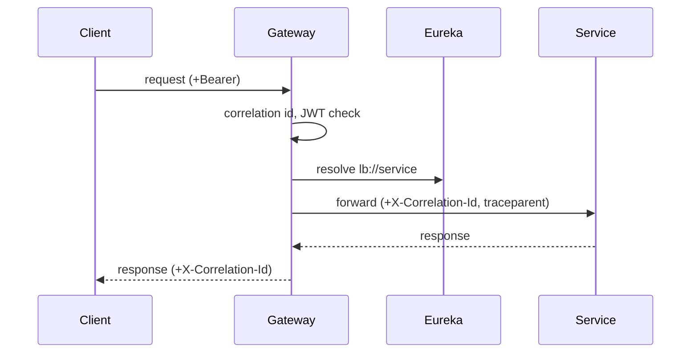

# 08 – API Gateway (Spring Cloud Gateway)

## 1. Feature Overview
Reactive Spring Cloud Gateway on :8080: routing by path through Eureka (`lb://`), JWT check at the edge, CORS, correlation id + request log, circuit-breaker fallbacks, aggregated Swagger UI.

## 2. Purpose
Clients (and Swagger) talk to one URL; downstream services are never exposed directly (in Docker/Kubernetes only the gateway publishes a port for clients).

## 3. Files Created
| File Path | Change Type | Description |
|---|---|---|
| api-gateway/src/main/java/com/example/gateway/ApiGatewayApplication.java | Created | |
| api-gateway/src/main/java/com/example/gateway/filter/CorrelationIdGlobalFilter.java | Created | Generates/propagates `X-Correlation-Id`, echoes it, logs `correlationId=… METHOD path -> status (ms)` |
| api-gateway/src/main/java/com/example/gateway/filter/JwtAuthGlobalFilter.java | Created | 401 JSON for missing/invalid/expired tokens on non-public paths |
| api-gateway/src/main/java/com/example/gateway/controller/FallbackController.java | Created | `/fallback/{service}` → 503 JSON |
| api-gateway/src/main/resources/application.yml | Created | Routes, CORS, timeouts, Swagger URLs, Resilience4j, Eureka, actuator |
| api-gateway/src/test/java/com/example/gateway/filter/JwtAuthGlobalFilterTest.java | Created | Public-path rules |
| api-gateway/Dockerfile, api-gateway/pom.xml | Created | |

## 4. Files Modified
None.

## 5. Implementation Details
Routes (all with a `CircuitBreaker` filter → `forward:/fallback/<service>`):

| Path predicate | Destination |
|---|---|
| `/api/students/**`, `/api/auth/**` | `lb://student-service` |
| `/api/courses/**` | `lb://course-service` |
| `/api/enrollments/**` | `lb://enrollment-service` |
| `/api/notifications/**` | `lb://notification-service` |
| `/docs/{student,course,enrollment,notification}/v3/api-docs` | each service's OpenAPI JSON (`RewritePath`) |

Public (no token): `POST /api/auth/{login,register,refresh,logout}`, `/actuator/**`, `/fallback/**`, Swagger UI/docs. Everything else needs a valid JWT; role rules stay in the services (defence in depth; the `Authorization` header is forwarded untouched, which also lets an ADMIN token reach `register`).
CORS: `CORS_ALLOWED_ORIGINS` (default `localhost:3000,4200,5173`), methods GET/POST/PUT/PATCH/DELETE/OPTIONS, exposes `X-Correlation-Id`. Timeouts: connect 2 s, response 15 s, TimeLimiter 20 s.

## 6. Architecture Details

## 7. Dependencies
`spring-cloud-starter-gateway`, `…-netflix-eureka-client`, `…-loadbalancer`, `…-circuitbreaker-reactor-resilience4j`, `springdoc-openapi-starter-webflux-ui`, Actuator, Micrometer/OTel, `common-web` (for `JwtTokenService` only).

## 8. Configuration Changes
`spring.cloud.gateway.*`, `springdoc.swagger-ui.urls`, `resilience4j.*` in `api-gateway/src/main/resources/application.yml`; `management.endpoints.web.exposure.include` contains `gateway` (route inspection at `/actuator/gateway/routes`).

## 9. Database Changes
None.

## 10. API Changes
The gateway adds no business endpoints. Swagger UI: `http://localhost:8080/swagger-ui.html` (service selector). Unauthorised: `401 {"status":401,"error":"Unauthorized","message":"Missing, invalid or expired token"}`. Downstream down: `503 {"status":503,"error":"Service Unavailable","message":"notification-service is currently unavailable. Please retry shortly."}`.

## 11. Communication Changes
Reads the Eureka registry; forwards HTTP to services.

## 12. Execution Instructions
Starts last in `scripts/start-local.sh` / depends on all services in Compose. Verify: `curl -i localhost:8080/api/students` → 401; login then call with the token.

## 13. Testing
`JwtAuthGlobalFilterTest` (3). Live: all 43 `e2e.py` assertions go through the gateway; stopping `notification-service` returned the 503 fallback while `/api/students` kept answering 200.

## 14. Pending Items
No rate limiting; `/actuator/gateway` and `/actuator/prometheus` are unauthenticated (restrict at the network level in production); no gateway-level integration test beyond the live E2E.
