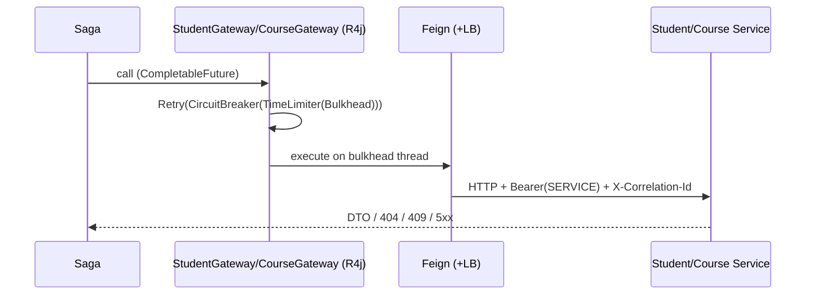

# 10 – Service-to-Service Communication (synchronous)

## 1. Feature Overview
Enrollment Service calls Student Service (eligibility, details) and Course Service (details, availability, seat reserve/release) with Spring Cloud OpenFeign, wrapped in Resilience4j ([18](18-Resilience4j-Patterns.md)).

## 2. Purpose
Validate students/courses and reserve/release seats for the saga without sharing databases.

## 3. Files Created
(`services/enrollment-service/src/main/java/com/example/enrollment/client/`)

| File Path | Change Type | Description |
|---|---|---|
| …/client/StudentClient.java, CourseClient.java | Created | `@FeignClient(name="student-service"/"course-service", url="${clients.*.url:}")` – name resolved via Eureka; the optional `url` property is only used by tests |
| …/client/RemoteDtos.java | Created | Consumer-side response records (`ignoreUnknown`), independent of the other services' DTOs |
| …/client/FeignConfig.java | Created | `RequestInterceptor` (service JWT + `X-Correlation-Id`), `ErrorDecoder` |
| …/client/RemoteExceptions.java | Created | NotFound(404) / Conflict(409) / Rejected(400,401,403,422) / Unavailable(other) |
| …/client/StudentGateway.java, CourseGateway.java | Created | Resilience facades (async) |
| …/client/RemoteCall.java | Created | Awaits a future and maps failures to business exceptions or `ServiceUnavailableException` |
| …/client/TracingContextPropagator.java | Created | Copies trace context + MDC into Resilience4j bulkhead threads |

## 4. Files Modified
None beyond `application.yml` (below).

## 5. Implementation Details
* HTTP status handling: 404 → "does not exist" rejection; 409 → no seats / conflict; other 4xx → rejection; 5xx/IO → retried then `ServiceUnavailableException` (HTTP 503 if surfaced).
* Authentication between services: each call carries a 5-minute JWT with role `SERVICE` signed with the shared secret.
* Timeouts: Feign connect 2 s / read 3 s; Resilience4j TimeLimiter 4 s; outer `RemoteCall` guard 15 s.
* Calls run on the Resilience4j bulkhead thread pool, so the propagator is required to keep one distributed trace (verified in Jaeger: one trace with spans from api-gateway, enrollment-, student- and course-service).

## 6. Architecture Details

## 7. Dependencies
`spring-cloud-starter-openfeign`, `spring-cloud-starter-loadbalancer`, `spring-cloud-starter-circuitbreaker-resilience4j`, `resilience4j-spring-boot3`, `spring-boot-starter-aop`, `feign-micrometer`.

## 8. Configuration Changes
`spring.cloud.openfeign.client.config.default.{connect-timeout,read-timeout,logger-level}`, `resilience4j.*`, optional `clients.student-service.url` / `clients.course-service.url`.

## 9. Database Changes
None.

## 10. API Changes
None (consumes endpoints of [04](04-Student-Service.md) and [05](05-Course-Service.md)).

## 11. Communication Changes
REST only. No other service calls Enrollment synchronously.

## 12. Execution Instructions
Nothing to start; used on every `POST /api/enrollments`. Inspect: `GET :8083/actuator/health` (circuit breakers), `/actuator/circuitbreakers`, `/actuator/prometheus` (`resilience4j_*`).

## 13. Testing
`ResilienceIT` (7) against a real HTTP stub: decode + service token + correlation id; 404/409 mapping without retries; retry-then-success; exhausted retries → breaker OPEN → fail fast → HALF_OPEN → CLOSED; slow dependency cut off; independent breakers. Saga unit tests mock the gateways. Live E2E covers the real Student/Course calls.

## 14. Pending Items
No contract tests (Pact) between consumer DTOs and provider responses.
