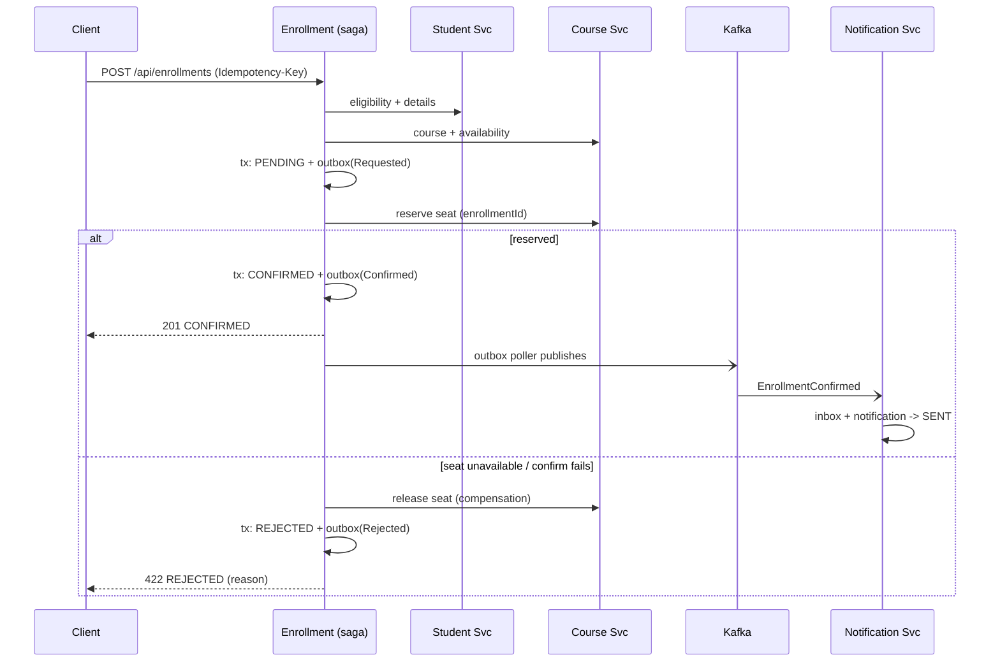

# 12 – Saga Pattern (orchestration)

## 1. Feature Overview
`EnrollmentSagaOrchestrator` in Enrollment Service coordinates the multi-service enrollment as a persistent state machine with compensation.

## 2. Purpose
Keep Student, Course and Enrollment data consistent without 2-phase commit.

## 3. Files Created
| File Path | Change Type | Description |
|---|---|---|
| services/enrollment-service/src/main/java/com/example/enrollment/saga/EnrollmentSagaOrchestrator.java | Created | Steps, persistence after every step, compensation |
| services/enrollment-service/src/main/java/com/example/enrollment/saga/SagaRecoveryJob.java | Created | Resumes stuck sagas |
| services/enrollment-service/src/main/java/com/example/enrollment/saga/SagaPausedException.java | Created | "Wait and retry later" signal |
| services/enrollment-service/src/main/java/com/example/enrollment/entity/SagaInstance.java, SagaState.java | Created | Persistent state |
| services/enrollment-service/src/main/java/com/example/enrollment/repository/SagaInstanceRepository.java | Created | |
| services/enrollment-service/src/test/java/com/example/enrollment/saga/EnrollmentSagaOrchestratorTest.java | Created | 10 unit tests |

## 4. Files Modified
None.

## 5. Implementation Details
States: `STARTED → STUDENT_VALIDATED → COURSE_VALIDATED → PENDING_CREATED → SEAT_RESERVED → COMPLETED`; any failure → `COMPENSATING → REJECTED`.

| Step | Action | On failure |
|---|---|---|
| 1 `STARTED` | Feign: eligibility + details of the student | 404 → "Student n does not exist"; not eligible → reason; unavailable → rejected |
| 2 `STUDENT_VALIDATED` | Feign: course ACTIVE and availability > 0 | "not active" / "No seats available" / "does not exist" |
| 3 `COURSE_VALIDATED` | **One local tx**: insert `PENDING` enrollment + `EnrollmentRequested` outbox row | DB unique `active_key` → "already has an active enrollment" |
| 4 `PENDING_CREATED` | Feign: reserve seat (idempotent per enrollmentId) | 409 → "no seats available" |
| 5 `SEAT_RESERVED` | **One local tx**: `CONFIRMED` + `EnrollmentConfirmed` outbox row | any exception → compensate |
| `COMPENSATING` | Release seat (idempotent; no-op if none), then **one tx**: mark/create enrollment `REJECTED` + `EnrollmentRejected` outbox row | seat service down → saga *pauses*, stays `COMPENSATING` |

Persistence & recovery: the saga row is saved after every step; remote calls happen **outside** DB transactions; each step is idempotent. `SagaRecoveryJob` (every 15 s) re-runs sagas not terminal and not updated for 30 s from their persisted state (optimistic `@Version` prevents two workers). Early rejections (before step 3) create a `REJECTED` enrollment row so history and notifications exist.

## 6. Architecture Details

## 7. Dependencies
Feign gateways ([10](10-Service-to-Service-Communication.md)), outbox ([13](13-Outbox-and-Inbox-Patterns.md)), `TransactionTemplate`.

## 8. Configuration Changes
`enrollment.saga.recovery-interval-ms` (15000), `stale-after-seconds` (30), `max-recovery-attempts` (20, currently informational).

## 9. Database Changes
`sms_saga_instances` ([03](03-MySQL-Database-Configuration.md)).

## 10. API Changes
Outcome codes of `POST /api/enrollments` ([06](06-Enrollment-Service.md)).

## 11. Communication Changes
Feign calls + outbox events as listed.

## 12. Execution Instructions
Observe: `mysql … -e "select saga_id,state,enrollment_id,failure_reason from sms_saga_instances" EnrollmentDB`; logs `Saga <id> step <STATE>`.

## 13. Testing
Unit: happy path order of calls; unknown/ineligible student; inactive/full/missing course; seat conflict → release + Rejected; **failure after seat reservation releases the seat**; compensation pause then recovery; DB duplicate constraint; idempotent replay; resume from `PENDING_CREATED` without repeating earlier steps. Integration (real MySQL): crash recovery via `SagaRecoveryJob.recover()` with an aged saga row; rejection path with real outbox rows. Live E2E: sold-out/unknown/inactive rejections.

## 14. Pending Items
`max-recovery-attempts` is configured but not yet enforced (a saga stuck in `COMPENSATING` is retried indefinitely every 15 s, which is intentional for the seat-release guarantee but has no alerting). A forced "confirm step fails after seat reserved" is verified by a unit test, not by a live fault injection.
