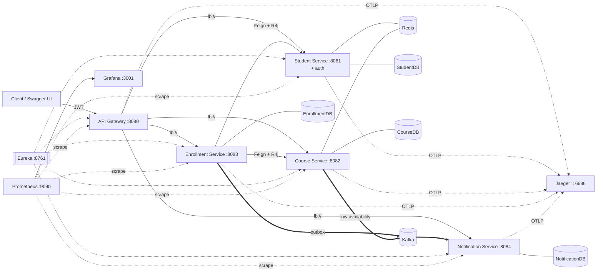
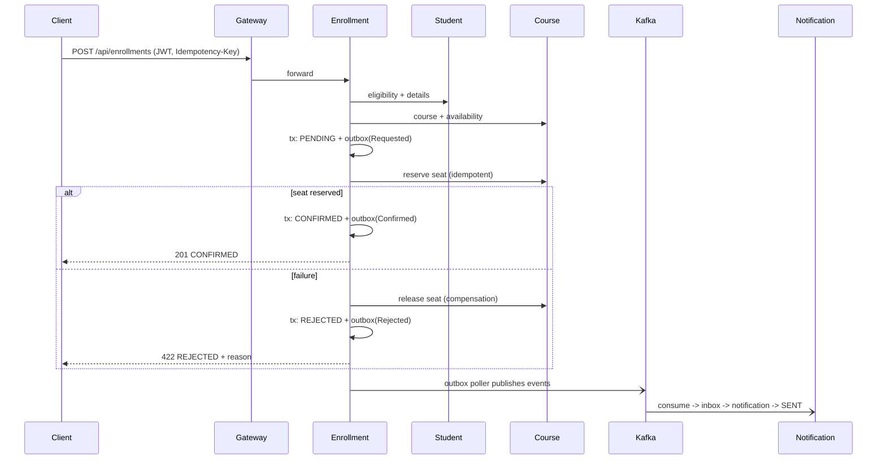

# Student Management System – Spring Boot Microservices

Java 21 · Spring Boot 3.4.5 · Spring Cloud 2024.0.1 · MySQL 8 (existing server) · Kafka · Redis · Docker · Kubernetes

Four independent microservices (Student, Course, Enrollment, Notification) behind a Spring Cloud Gateway with Eureka discovery, an orchestration **saga**, **transactional outbox / inbox**, **idempotency**, **CQRS**, Redis caching, JWT security, Resilience4j, OpenTelemetry tracing and Prometheus/Grafana monitoring.

> Detailed, per-feature documentation (files, config, DB, APIs, tests, pending items) is in [`Documentation/`](#documentation-index). This README is the entry point.

## Contents
1. [Architecture](#1-architecture) · 2. [Services](#2-services-and-responsibilities) · 3. [Technology](#3-technology-stack-and-versions) · 4. [Project structure](#4-maven-project-structure) · 5. [Database](#5-mysql-database-configuration) · 6. [Run it](#6-running-the-system) · 7. [API endpoints](#7-api-endpoints) · 8. [Gateway](#8-api-gateway) · 9. [Eureka](#9-eureka-service-discovery) · 10. [Sync communication](#10-synchronous-communication) · 11. [Kafka](#11-kafka-topics-and-events) · 12. [Saga](#12-saga-workflow) · 13. [Outbox](#13-outbox-implementation) · 14. [Inbox & idempotency](#14-inbox-and-idempotency) · 15. [CQRS](#15-cqrs) · 16. [Redis](#16-redis-caching) · 17. [Security](#17-authentication-and-authorization) · 18. [Logging & monitoring](#18-logging-tracing-and-monitoring) · 19. [Docker](#19-docker) · 20. [Kubernetes](#20-kubernetes) · 21. [Testing](#21-testing) · 22. [Samples](#22-sample-api-requests-and-responses) · 23. [Troubleshooting](#23-troubleshooting) · 24. [Checklist](#24-checklist-completed-and-pending) · 25. [Docs index](#documentation-index)

## 1. Architecture


**Enrollment workflow** (details in [§12](#12-saga-workflow)):


## 2. Services and responsibilities
| Service | Port | DB | Responsibilities |
|---|---|---|---|
| api-gateway | 8080 | – | Routing, JWT edge check, CORS, correlation ids, fallbacks, Swagger aggregation |
| eureka-server | 8761 | – | Registry |
| student-service | 8081 | StudentDB | Student CRUD/search/status/eligibility, **authentication** (users, JWT, refresh tokens) |
| course-service | 8082 | CourseDB | Course/category CRUD, availability, atomic seat reserve/release, low-availability events |
| enrollment-service | 8083 | EnrollmentDB | Enroll/cancel/history, saga, outbox, CQRS, duplicate prevention |
| notification-service | 8084 | NotificationDB | Kafka consumers, inbox, notification history, retrying e-mail **simulation** |

## 3. Technology stack and versions
Java **21** (OpenJDK 21.0.7) · Spring Boot **3.4.5** · Spring Cloud **2024.0.1** (Gateway/OpenFeign/Eureka 4.2.1) · Hibernate 6.6 / Spring Data JPA · Flyway 10.20 · MySQL Connector/J 9.1 · Kafka (Spring Kafka 3.3.5) · Redis 7 (Lettuce) · Resilience4j 2.2.0 · jjwt 0.12.6 · springdoc 2.8.6 · Micrometer + OpenTelemetry (OTLP) · Prometheus + Grafana 11.3 · JUnit 5.11 / Mockito 5.14 / Testcontainers 1.20.6 · Docker 28 / Compose v2.

## 4. Maven project structure
```
StudentManagement/
├── pom.xml                      parent (Boot 3.4.5, Cloud BOM, failsafe)
├── common/
│   ├── event-contracts/         Kafka event records + topic names (no Spring/JPA)
│   └── common-web/              JWT, filters, error handling, OpenAPI, Kafka health (auto-configuration)
├── eureka-server/   api-gateway/
├── services/{student,course,enrollment,notification}-service/   (src/main + src/test, Dockerfile)
├── database/<service>/README.md schema notes (Flyway scripts live in each service's resources/db/migration)
├── docker/README.md             how containers reach the host MySQL
├── docker-compose.yml  .env.example
├── kubernetes/                  optional manifests (Kustomize)
├── monitoring/{prometheus,grafana}/
├── scripts/                     start-local.sh stop-local.sh e2e.py verify-db.sh
└── Documentation/               00 … 29 (see index)
```
Tests live next to the code (`src/test/java`); unit tests `*Test` (surefire), integration tests `*IT` (failsafe).

## 5. MySQL database configuration
Each service uses **its own existing database** on the existing MySQL server: `StudentDB`, `CourseDB`, `EnrollmentDB`, `NotificationDB`.

```
jdbc:mysql://${MYSQL_HOST:localhost}:${MYSQL_PORT:3306}/StudentDB?useSSL=false&allowPublicKeyRetrieval=true&serverTimezone=UTC
spring.datasource.username=${MYSQL_USER}    spring.datasource.password=${MYSQL_PASSWORD}
```
* **Existing tables and data are preserved.** Flyway adds only new `sms_*` tables (and `flyway_schema_history`) using `baseline-on-migrate`; Hibernate is `ddl-auto: validate`; `flyway.clean` is disabled. No cross-database foreign keys.
* Migrations: `services/<service>/src/main/resources/db/migration/V*.sql` (student V1, V2; course/enrollment/notification V1). They run automatically on service start. Add changes as new `V<n>__…sql`; never edit applied ones.
* Check: `scripts/verify-db.sh` (read-only). Full schema: [Documentation/03](Documentation/03-MySQL-Database-Configuration.md).
* **Credentials:** at the owner's request the local dev defaults (`abhig` / the dev password set in `application.yml`) are the fallbacks of `MYSQL_USER`/`MYSQL_PASSWORD` in each `application.yml`; override via environment in any real deployment (and remove the defaults before publishing).

## 6. Running the system
Prerequisites: JDK 21, Maven 3.8+, Docker, MySQL running with the four databases.
```bash
docker compose up -d kafka redis jaeger          # infrastructure (host ports 9092, 6379, 16686)
mvn -DskipTests package
scripts/start-local.sh                           # Eureka -> 4 services -> gateway (logs in logs/)
python3 scripts/e2e.py                           # end-to-end checks through http://localhost:8080
scripts/stop-local.sh
```
Initial admin: `admin` / `Admin@123` (`ADMIN_PASSWORD`). Swagger UI: http://localhost:8080/swagger-ui.html · Eureka: http://localhost:8761 · Jaeger: http://localhost:16686.
Everything in containers: [§19](#19-docker).

## 7. API endpoints
All calls go through the gateway (`:8080`); `Authorization: Bearer <accessToken>` except where noted. Roles: **A**=ADMIN, **F**=STAFF, **S**=STUDENT, **X**=internal SERVICE.

| Area | Endpoint | Roles |
|---|---|---|
| Auth | `POST /api/auth/register` (public: STUDENT; ADMIN token: any role), `POST /api/auth/login`, `POST /api/auth/refresh`, `POST /api/auth/logout` (public) · `GET /api/auth/me` | any |
| Students | `POST /api/students` · `GET /api/students?search&status&gender&page&size&sort` · `GET/PUT /api/students/{id}` · `PATCH /api/students/{id}/status` · `GET /api/students/{id}/eligibility` · `DELETE /api/students/{id}` | A,F (S own, X read) · delete A |
| Courses | `POST/PUT/DELETE /api/courses[/{id}]`, `PATCH /api/courses/{id}/status` · `GET /api/courses?search&categoryId&status&minFees&maxFees&availableOnly` · `GET /api/courses/{id}` · `GET /api/courses/{id}/availability` · `POST /api/courses/{id}/seats/reserve|release` · `/api/courses/categories` CRUD | write A,F · read all · seats A,X |
| Enrollments | `POST /api/enrollments` (`Idempotency-Key`) · `POST /api/enrollments/{id}/cancel` · `PUT /api/enrollments/{id}` · `GET /api/enrollments[/{id}]` · `GET /api/enrollments/student/{id}` · `GET /api/enrollments/course/{id}` | A,F (S own) |
| Notifications | `GET /api/notifications` · `GET /api/notifications/{id}` · `GET /api/notifications/student/{id}` · `POST /api/notifications/{id}/retry` | A,F (S own history) |

Errors use one JSON shape: `{"timestamp","status","error","message","path","fieldErrors?"}`. Status codes: 200/201/202/204, 400 validation, 401, 403, 404, 409 conflict/duplicate/no seats, 422 business rule/rejected, 503 dependency down.

## 8. API gateway
Routes `/api/students/**`+`/api/auth/**` → student-service, `/api/courses/**` → course-service, `/api/enrollments/**` → enrollment-service, `/api/notifications/**` → notification-service (all `lb://`, circuit breaker + 503 fallback). Global filters: correlation id + request log, JWT check (public: login/register/refresh/logout, actuator, Swagger). CORS from `CORS_ALLOWED_ORIGINS`. See [Documentation/08](Documentation/08-API-Gateway-Spring-Cloud-Gateway.md).

## 9. Eureka service discovery
`eureka-server` on :8761; every service registers as `<name>-service`; no hard-coded URLs anywhere (`lb://…`, `@FeignClient(name=…)`). [Documentation/09](Documentation/09-Eureka-Service-Discovery.md).

## 10. Synchronous communication
Enrollment → Student (`/eligibility`, `/{id}`) and → Course (`/{id}`, `/availability`, `/seats/reserve|release`) with OpenFeign + Resilience4j (retry 3×, circuit breaker, 4 s time limiter, thread-pool bulkhead), service-to-service JWT (role SERVICE), correlation id and trace propagation. [Documentation/10](Documentation/10-Service-to-Service-Communication.md), [18](Documentation/18-Resilience4j-Patterns.md).

## 11. Kafka topics and events
| Topic | Event | Producer → Consumer |
|---|---|---|
| `enrollment.requested` | EnrollmentRequested | Enrollment (outbox) → Notification (recorded, no notification) |
| `enrollment.confirmed` | EnrollmentConfirmed | → notification “confirmed” |
| `enrollment.rejected` | EnrollmentRejected | → notification “rejected + reason” |
| `enrollment.cancelled` | EnrollmentCancelled | → notification “cancelled” |
| `course.low-availability` | LowCourseAvailability | Course (after commit) → admin notification |
| `<topic>.DLT` | dead letters | Notification error handler |

3 partitions each, key = enrollmentId/courseId, JSON, producers `acks=all` + idempotence, consumer group `notification-service`, ack per record, exponential retry then dead-letter. [Documentation/11](Documentation/11-Kafka-Event-Driven-Architecture.md).

## 12. Saga workflow
Orchestrated in Enrollment Service, state persisted in `sms_saga_instances` after every step: validate student → validate course → create PENDING (+outbox) → reserve seat → CONFIRM (+outbox) → publish → notify. Failures reject the enrollment and run compensation (release the seat, publish `EnrollmentRejected`); sagas interrupted by a crash or an outage are resumed by `SagaRecoveryJob`. [Documentation/12](Documentation/12-Saga-Pattern.md).

## 13. Outbox implementation
`sms_outbox_events` is written in the **same transaction** as the enrollment change; a scheduled publisher (`FOR UPDATE SKIP LOCKED`, wait for broker ack, exponential backoff, never drops) publishes to Kafka. Verified by pausing the Kafka container during an enrollment: events stayed PENDING and were delivered after recovery. [Documentation/13](Documentation/13-Outbox-and-Inbox-Patterns.md).

## 14. Inbox and idempotency
Notification Service stores each consumed `eventId` in `sms_inbox_messages` (unique) together with its effect; notifications are unique per `(enrollment, type)`. Enrollment requests are idempotent via `Idempotency-Key`; duplicate active enrollments are blocked by a unique generated column; seat reserve/release are idempotent per `enrollmentId`. [Documentation/14](Documentation/14-Idempotency.md).

## 15. CQRS
Enrollment commands (`Create`, `Update`, `Cancel`) and queries (`Get`, `Search`, `StudentHistory`, `CourseEnrollments`) have separate handler classes; queries are read-only and never call other services. [Documentation/15](Documentation/15-CQRS-Implementation.md).

## 16. Redis caching
Student information, course information and course availability via Spring Cache on Redis (prefix `sms:`, TTL 10 min / 10 min / 1 min), updated on change and evicted after commit; Redis failures degrade to MySQL. [Documentation/16](Documentation/16-Redis-Caching.md).

## 17. Authentication and authorization
Spring Security + HS256 JWT (15 min) + rotating refresh tokens (7 days, stored hashed), BCrypt passwords, roles ADMIN/STAFF/STUDENT (+ internal SERVICE), `@PreAuthorize` rules. Auth is owned by Student Service (two extra tables in StudentDB). [Documentation/17](Documentation/17-Spring-Security-and-JWT.md).

## 18. Logging, tracing and monitoring
SLF4J/Logback with `[app,traceId,spanId,correlationId]` (JSON via `LOGGING_STRUCTURED_FORMAT_CONSOLE=logstash`); OpenTelemetry → Jaeger (a single trace spans gateway, enrollment, student, course); Micrometer → Prometheus → Grafana dashboard “Student Management – Overview”; Actuator liveness/readiness with MySQL, Redis and Kafka checks. [Documentation/21](Documentation/21-Logging-and-Monitoring.md), [22](Documentation/22-OpenTelemetry-and-Distributed-Tracing.md), [23](Documentation/23-Health-Checks-and-Actuator.md).

## 19. Docker
```bash
cp .env.example .env                              # MYSQL_USER, MYSQL_PASSWORD, JWT_SECRET, …
docker compose --profile mysql-proxy up -d --build   # all services + Kafka, Redis, Jaeger, Prometheus, Grafana
```
MySQL is **not** containerised; containers use `MYSQL_HOST=host.docker.internal`. Because the host MySQL listens on 127.0.0.1 only, choose how containers reach it – [docker/README.md](docker/README.md) (Option A: reconfigure MySQL; Option B: the optional `mysql-proxy` profile). **Status: images build and infra/monitoring containers were verified, but the full application stack under Compose has not been run yet** (see checklist). [Documentation/24](Documentation/24-Docker-and-Docker-Compose.md).

## 20. Kubernetes
Optional Kustomize manifests in `kubernetes/` (Deployments, Services, ConfigMap, Secret placeholders, probes, resources, Kafka/Redis StatefulSets, external-MySQL alias). Edit `02-mysql-external.yaml`, create the Secret, `kubectl apply -k kubernetes/`. **Not applied to a cluster** (structurally validated only). [Documentation/25](Documentation/25-Kubernetes.md).

## 21. Testing
```bash
mvn test            # 82 unit tests (JUnit 5, Mockito)
mvn verify          # + 36 integration tests (Testcontainers: MySQL 8, Kafka, Redis) - needs Docker
python3 scripts/e2e.py   # 43 end-to-end assertions through the gateway (needs the running stack)
```
Integration tests never touch the real databases. Details and results: [Documentation/26](Documentation/26-Unit-and-Integration-Testing.md).

## 22. Sample API requests and responses
Captured from a live run through the gateway (`http://localhost:8080`); ids and timestamps vary. Tokens are truncated.

#### Login
```http
POST /api/auth/login
{"username": "admin", "password": "Admin@123"}
```
`200`
```json
{
  "accessToken": "eyJhbGciOiJIUzI1NiJ9…",
  "refreshToken": "Sq3N0BzSBcVpOCqpJUFo…",
  "tokenType": "Bearer",
  "expiresInSeconds": 900,
  "username": "admin",
  "role": "ADMIN",
  "studentId": null
}
```

#### Create a course (1 seat)
```http
POST /api/courses
{"courseName": "Java Microservices", "courseCode": "JMS-9B8F3", "description": "Spring Boot + Kafka", "categoryId": 4, "durationWeeks": 12, "fees": 24999.0, "totalSeats": 1}
```
`201`
```json
{
  "courseId": 7,
  "courseName": "Java Microservices",
  "courseCode": "JMS-9B8F3",
  "description": "Spring Boot + Kafka",
  "categoryId": 4,
  "categoryName": "Sample-9b8f3",
  "durationWeeks": 12,
  "fees": 24999.0,
  "totalSeats": 1,
  "availableSeats": 1,
  "status": "ACTIVE",
  "createdAt": "2026-11-10T16:52:32.815322",
  "updatedAt": "2026-11-10T16:52:32.815355"
}
```

#### Register a student
```http
POST /api/students
{"firstName": "Asha", "lastName": "Rao", "email": "asha.9b8f3@example.com", "phoneNumber": "+91 9876543210", "dateOfBirth": "2002-05-14", "gender": "FEMALE"}
```
`201`
```json
{
  "studentId": 61,
  "firstName": "Asha",
  "lastName": "Rao",
  "email": "asha.9b8f3@example.com",
  "phoneNumber": "+91 9876543210",
  "dateOfBirth": "2002-05-14",
  "gender": "FEMALE",
  "address": null,
  "enrollmentDate": "2026-11-10",
  "status": "ACTIVE",
  "createdAt": "2026-11-10T16:52:32.84404",
  "updatedAt": "2026-11-10T16:52:32.844073"
}
```

#### Enroll (success)
```http
POST /api/enrollments  (Idempotency-Key: demo-…)
{"studentId": 61, "courseId": 7}
```
`201`
```json
{
  "result": "CONFIRMED",
  "message": "Enrollment confirmed",
  "enrollment": {
    "enrollmentId": 67,
    "studentId": 61,
    "courseId": 7,
    "studentName": "Asha Rao",
    "courseName": "Java Microservices",
    "enrollmentDate": "2026-11-10T16:52:33.029384",
    "enrollmentStatus": "CONFIRMED",
    "remarks": null,
    "createdAt": "2026-11-10T16:52:33.030018",
    "updatedAt": "2026-11-10T16:52:33.105129"
  }
}
```

#### Replay with the same Idempotency-Key
`201` – same `enrollmentId` (67), no second seat reserved.

#### Duplicate active enrollment (new key)
```http
POST /api/enrollments
{"studentId": 61, "courseId": 7}
```
`409`
```json
{
  "timestamp": "2026-11-10T11:22:33.194214259Z",
  "status": 409,
  "error": "Conflict",
  "message": "Student 61 already has an active enrollment in course 7",
  "path": "/api/enrollments"
}
```

#### Enroll into the full course (saga compensation → rejected)
```http
POST /api/enrollments
{"studentId": 62, "courseId": 7}
```
`422`
```json
{
  "result": "REJECTED",
  "message": "No seats available in course 7",
  "enrollment": {
    "enrollmentId": 68,
    "studentId": 62,
    "courseId": 7,
    "studentName": "Ravi Kumar",
    "courseName": null,
    "enrollmentDate": "2026-11-10T16:52:33.360792",
    "enrollmentStatus": "REJECTED",
    "remarks": "No seats available in course 7",
    "createdAt": "2026-11-10T16:52:33.36128",
    "updatedAt": "2026-11-10T16:52:33.361299"
  }
}
```

#### Availability
```http
GET /api/courses/7/availability
```
`200`
```json
{
  "courseId": 7,
  "status": "ACTIVE",
  "totalSeats": 1,
  "availableSeats": 0,
  "available": false
}
```

#### Cancel
```http
POST /api/enrollments/67/cancel
{"reason": "changed my mind"}
```
`200`
```json
{
  "enrollmentId": 67,
  "studentId": 61,
  "courseId": 7,
  "studentName": "Asha Rao",
  "courseName": "Java Microservices",
  "enrollmentDate": "2026-11-10T16:52:33.029384",
  "enrollmentStatus": "CANCELLED",
  "remarks": "changed my mind",
  "createdAt": "2026-11-10T16:52:33.030018",
  "updatedAt": "2026-11-10T16:52:33.571593"
}
```

#### Notification history of the student
```http
GET /api/notifications/student/61
```
`200`
```json
{
  "content": [
    {
      "notificationId": 94,
      "notificationType": "ENROLLMENT_CANCELLED",
      "recipientEmail": "asha.9b8f3@example.com",
      "message": "Hi Asha Rao, your enrollment #67 in Java Microservices has been cancelled.",
      "status": "SENT",
      "retryCount": 0
    },
    {
      "notificationId": 92,
      "notificationType": "ENROLLMENT_CONFIRMED",
      "recipientEmail": "asha.9b8f3@example.com",
      "message": "Hi Asha Rao, your enrollment #67 in Java Microservices is confirmed.",
      "status": "SENT",
      "retryCount": 0
    }
  ],
  "totalElements": 2
}
```

#### No token
`GET /api/students` → `401`
```json
{
  "timestamp": "2026-11-10T11:22:39.645578023Z",
  "status": 401,
  "error": "Unauthorized",
  "message": "Missing, invalid or expired token",
  "path": "/api/students"
}
```


## 23. Troubleshooting
| Symptom | Cause / fix |
|---|---|
| Service fails with `Access denied for user` / `Unknown database` | Check `MYSQL_USER`/`MYSQL_PASSWORD`; the four databases must already exist (the app never creates them) |
| `Schema … is not empty` / Flyway validation error | Keep `baseline-on-migrate: true`; never edit an applied migration (new `V<n>` instead) |
| Hibernate `Schema-validation` error | Entity and migration differ – fix the migration with a new version, not `ddl-auto` |
| Containers cannot connect to MySQL | Host MySQL is bound to 127.0.0.1 and the user is `@localhost` – see `docker/README.md` |
| `401` from the gateway | Missing/expired token – log in again; the access token lives 15 min |
| `503 … is currently unavailable` | Downstream down (circuit-breaker fallback) – check Eureka and the service log |
| Enrollment returns `202 IN_PROGRESS` | A dependency was down; `SagaRecoveryJob` resumes it within ~45 s |
| Events not arriving | `docker compose ps kafka`; look at `outbox_events_pending` / the `sms_outbox_events` table (it retries with backoff) |
| `Dead-letter publication … failed` | DLT topics are created by Notification Service at startup (`<topic>.DLT`) |
| JVM log `ClassNotFoundException` after rebuilding | You rebuilt jars while the services were running – restart them (`scripts/stop-local.sh && scripts/start-local.sh`) |
| Testcontainers cannot start Kafka | The tests use `confluentinc/cp-kafka:7.6.0`; make sure Docker can pull it |
| Port already in use | `scripts/stop-local.sh` stops anything on 8080–8084/8761 |

## 24. Checklist (completed and pending)
Legend: ✅ implemented **and verified** · ⚠️ implemented, verification partial · ⬜ not done.

| # | Acceptance criterion | Status | Evidence |
|---|---|---|---|
| 1 | Four services run independently | ✅ | each starts alone; health UP |
| 2 | Each connects to its existing MySQL DB | ✅ | live + `scripts/verify-db.sh` |
| 3 | Existing DBs/tables/data preserved | ✅ | row counts unchanged; no code touches them; IT with legacy table |
| 4 | Flyway migrations work | ✅ | applied on 4 real DBs + Testcontainers |
| 5 | All APIs through the gateway | ✅ | 43 E2E assertions via :8080 |
| 6 | Eureka discovery | ✅ | `lb://` routing, Feign by name |
| 7 | Student/Course validation over REST | ✅ | saga E2E + `ResilienceIT` |
| 8 | Kafka publish/consume | ✅ | live + ITs |
| 9 | Enrollment end-to-end | ✅ | E2E |
| 10 | Seat reserve/release | ✅ | E2E + `SeatConcurrencyIT` |
| 11 | Saga compensation | ✅ | unit (release after reservation failure/confirm failure), integration, E2E sold-out; “confirm fails after reservation” is unit-tested, not fault-injected live |
| 12 | Outbox reliable publishing | ✅ | Kafka-outage IT |
| 13 | Inbox/idempotency | ✅ | ITs + E2E |
| 14 | Redis caching | ✅ | IT + live keys |
| 15 | JWT + RBAC | ✅ | unit, IT, 15 E2E assertions |
| 16 | Resilience4j | ✅ | `ResilienceIT`, live gateway fallback |
| 17 | Logging, tracing, metrics, health | ✅ | Jaeger trace across 4 services, Prometheus 6/6 up, Grafana datasource/dashboard, JSON logs, health |
| 18 | **Docker Compose runs the app on existing MySQL** | ⚠️ | images build, infra + monitoring containers verified; **app containers not run** (needs MySQL reachability decision – [docker/README.md](docker/README.md)) |
| 19 | Unit + integration tests pass | ✅ | 82 + 36 green |
| 20 | Kubernetes manifests provided | ⚠️ | provided, structurally validated, **not applied** |
| 21 | README complete | ✅ | this file |
| 22 | Implementation docs accurate | ✅ | `Documentation/00–29` + automated path check |

Known gaps: see [Documentation/29 – Known issues and pending items](Documentation/29-Implementation-Change-Log.md#known-issues-and-pending-items).

## Documentation index
| # | Document |
|---|---|
| 00 | [Project Overview](Documentation/00-Project-Overview.md) |
| 01 | [Project Setup and Maven Configuration](Documentation/01-Project-Setup-and-Maven-Configuration.md) |
| 02 | [Java and Spring Boot Configuration](Documentation/02-Java-and-Spring-Boot-Configuration.md) |
| 03 | [MySQL Database Configuration](Documentation/03-MySQL-Database-Configuration.md) |
| 04 | [Student Service](Documentation/04-Student-Service.md) |
| 05 | [Course Service](Documentation/05-Course-Service.md) |
| 06 | [Enrollment Service](Documentation/06-Enrollment-Service.md) |
| 07 | [Notification Service](Documentation/07-Notification-Service.md) |
| 08 | [API Gateway](Documentation/08-API-Gateway-Spring-Cloud-Gateway.md) |
| 09 | [Eureka Service Discovery](Documentation/09-Eureka-Service-Discovery.md) |
| 10 | [Service-to-Service Communication](Documentation/10-Service-to-Service-Communication.md) |
| 11 | [Kafka Event-Driven Architecture](Documentation/11-Kafka-Event-Driven-Architecture.md) |
| 12 | [Saga Pattern](Documentation/12-Saga-Pattern.md) |
| 13 | [Outbox and Inbox Patterns](Documentation/13-Outbox-and-Inbox-Patterns.md) |
| 14 | [Idempotency](Documentation/14-Idempotency.md) |
| 15 | [CQRS Implementation](Documentation/15-CQRS-Implementation.md) |
| 16 | [Redis Caching](Documentation/16-Redis-Caching.md) |
| 17 | [Spring Security and JWT](Documentation/17-Spring-Security-and-JWT.md) |
| 18 | [Resilience4j Patterns](Documentation/18-Resilience4j-Patterns.md) |
| 19 | [Distributed Concurrency Control](Documentation/19-Distributed-Concurrency-Control.md) |
| 20 | [Background Processing](Documentation/20-Background-Processing.md) |
| 21 | [Logging and Monitoring](Documentation/21-Logging-and-Monitoring.md) |
| 22 | [OpenTelemetry and Distributed Tracing](Documentation/22-OpenTelemetry-and-Distributed-Tracing.md) |
| 23 | [Health Checks and Actuator](Documentation/23-Health-Checks-and-Actuator.md) |
| 24 | [Docker and Docker Compose](Documentation/24-Docker-and-Docker-Compose.md) |
| 25 | [Kubernetes](Documentation/25-Kubernetes.md) |
| 26 | [Unit and Integration Testing](Documentation/26-Unit-and-Integration-Testing.md) |
| 27 | [API Documentation](Documentation/27-API-Documentation.md) |
| 28 | [Configuration and Environment Variables](Documentation/28-Configuration-and-Environment-Variables.md) |
| 29 | [Implementation Change Log](Documentation/29-Implementation-Change-Log.md) |
